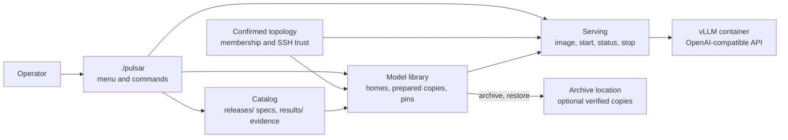

# Pulsar Inference Stack

[](LICENSE)

*Exact-spec vLLM serving for NVIDIA DGX Spark GB10 systems. One spec fixes the
model files, image, execution settings, and hardware geometry, and every launch
rechecks all of them.*

Pulsar serves catalog model recipes on NVIDIA DGX Spark GB10 systems with vLLM.
It manages the model files, prepares them on the selected machines, checks the
exact serving configuration, and starts or stops the service. Verified archives
provide a separate recovery path.

You select a **spec** from the catalog: a serving specification that fixes the
model files, container image, execution settings, and required hardware together.
Its **recipe** is the execution configuration. You can browse, restore, prepare,
and serve published specs using this public repository alone. The separate
private `pulsar-inference-workbench` owns model onboarding and experiments.

## How it fits together



The spec is the expected identity for every step. The catalog says what to
serve, the model library puts verified bytes where the recipe needs them, and
serving launches the exact configuration on confirmed nodes. `release_spec/`
owns spec documents, identity, and evidence verification; `model_library/`
owns homes, prepared copies, pins, and archives; `cluster/` and
`serving_guard/` own multi-node launch and bounded trials. See
[Architecture](docs/ARCHITECTURE.md) for ownership and the contribution cycle.

## Design rules

- **Exact spec identity.** The model snapshot, image digest, engine arguments,
  container settings, and hardware geometry form the recipe identity. An
  execution override creates a distinct modified recipe with its own identity.
  Git commits are provenance, never runtime identity.
- **Confirmed topology only.** Commands use the confirmed membership and the
  recipe's node count. Pulsar never infers serving geometry from spare
  discovered nodes and never silently changes a transport.
- **Verified files on every rank.** A home is the one verified source copy of a
  snapshot. Every serving rank needs a complete prepared copy before launch.
  Manifests and actual byte verification establish identity; records only
  locate bytes.
- **Explicit, non-replacing operations.** Start does not pull a missing image
  or replace a running service without its own flag. Stop preserves model
  files, pins, and archives. There is no archive-deletion command.
- **Evidence is separate from membership.** A schema-valid spec under
  `releases/` is a catalog member. State, review, measurements, and archive
  observations are metadata and never gate the catalog or serving.

## Before you start

Use Python 3.11 or newer, Bash, Git, and util-linux `flock`. Serving nodes need
Docker with NVIDIA GPU access and node-local storage for model files. Downloads
need the `hf` CLI and any required Hub authentication on the node receiving the
files. Inter-node operations need OpenSSH, rsync, iproute2, and the confirmed
control and RoCE connections required by the recipe.

Interactive menus use Gum, bundled for arm64 Linux. Initial key-based SSH login
must already work before Pulsar enrolls host identities. See
[installation prerequisites](docs/OPERATIONS.md#installation-prerequisites)
for controller tools, storage requirements, and noninteractive use.

```sh
git clone https://github.com/luisefigueroa/pulsar-inference-stack.git
cd pulsar-inference-stack
./pulsar help
./pulsar models list
```

Catalog browsing needs no configured cluster and reads saved information. It
does not download files or check whether a model is running. Run `./pulsar` on
a terminal for the menu; it offers setup and read-only browsing before the
cluster is configured. Archive storage is optional.

## Serve a catalog recipe

Run each step separately and inspect its result before continuing. These
examples use a one-node recipe. For a multi-node recipe, keep `--node NODE`
when choosing the source copy's location during acquisition or restoration,
but omit it from preparation, image, start, status, and stop commands. Those
commands use the recipe's node count and the confirmed topology.

### 1. Set up the cluster and select a spec

```sh
./pulsar topology setup
./pulsar topology show
./pulsar models list
./pulsar models show SPEC
```

Setup guides membership and SSH trust through separate confirmations, then
checks readiness. For the initial `models show`, `SPEC` can be the unique
12-character prefix displayed by `models list`. Copy the complete ID from its
`Spec ID` field for subsequent steps; image commands require all 64 characters.
Replace `NODE` with a confirmed hostname from `topology show`.

Inspect the selected spec's image, node count, required snapshots, and any
launch limitation. This walkthrough uses ordinary `start`. A recipe with a
serving guard requires [bounded guarded serving](docs/GUARDED_SERVING.md).

### 2. Obtain the model files

Download the exact target snapshot to a confirmed node, creating its verified
source copy, called its **home**:

```sh
./pulsar model acquire SPEC --snapshot target --node NODE --yes
```

If you have an archive, [configure its location](docs/OPERATIONS.md#archive-location)
and restore instead of downloading:

```sh
./pulsar model restore SPEC --snapshot target --node NODE --plan
./pulsar model restore SPEC --snapshot target --node NODE --yes
```

For schema-3 specs, repeat acquisition or restoration for every additional
snapshot declared by the spec, replacing `target` with its name. A checkpoint
bundled within the target needs no second download. See
[required snapshots](docs/OPERATIONS.md#recipes-requiring-a-draft-checkpoint).
Continue when every required snapshot has a verified home.

### 3. Prepare the serving copies

```sh
./pulsar model prepare SPEC --node NODE --plan
./pulsar model prepare SPEC --node NODE --yes
```

The preview reports reuse, transfers, and storage capacity. Preparation makes
the complete recipe's files available on every serving node; it does not start
the model.

### 4. Check and stage the exact image

```sh
./pulsar image check SPEC --node NODE
```

If the pinned image is missing, review and explicitly apply a registry pull:

```sh
./pulsar image stage SPEC --node NODE --pull --plan
./pulsar image stage SPEC --node NODE --pull --yes
```

Staging verifies the image on the selected serving nodes. It does not launch
or replace a service. For an image already held locally, see
[image staging options](docs/OPERATIONS.md#check-and-stage-the-image).

### 5. Start, use, and stop the service

Configure any API authentication before starting; see
[your first API request](docs/OPERATIONS.md#send-your-first-api-request).

```sh
./pulsar start SPEC --node NODE --dry-run
./pulsar start SPEC --node NODE
./pulsar status SPEC --node NODE
```

The dry run reports prerequisites; start repeats its checks and performs the
launch. If a command reports a blocker, follow its next step before continuing.
Start neither pulls a missing image nor replaces an existing service without
the corresponding explicit flag.

Ordinary start prints `READY` only after a test completion succeeds. Use the
reported API URL and served model name for your requests. `status` checks the
live service separately from saved catalog observations.

Send a first request from a machine that can reach the endpoint. Replace the
URL with the one start reported and `SERVED_MODEL` with the served name:

```sh
PULSAR_API_URL='http://127.0.0.1:8000/v1'
curl --fail-with-body --silent --show-error \
  "$PULSAR_API_URL/completions" \
  -H 'Content-Type: application/json' \
  -d '{"model":"SERVED_MODEL","prompt":"Write one sentence about the Moon.","max_tokens":32}'
```

An authenticated service also needs the `Authorization: Bearer` header shown in
[your first API request](docs/OPERATIONS.md#send-your-first-api-request). The
generated text is in `choices[0].text`. This completion demonstrates API use;
it is not an accuracy benchmark or qualification result.

When finished:

```sh
./pulsar stop SPEC --node NODE
```

Stop retains model files, pins, and archives. Storage cleanup is a
[separate operation](docs/OPERATIONS.md#stop-and-reclaim-storage).

## Commands at a glance

`./pulsar help` lists every command, and each command accepts `--help`.

| Group | Commands | Purpose |
| --- | --- | --- |
| Set up this checkout | `topology`, `ssh-trust`, `configure archive-root`, `doctor` | Confirm membership and SSH trust, select the archive location, and run diagnostics |
| Catalog and model files | `models`, `model` | Browse specs, published results, and saved observations; acquire, restore, prepare, move, pin, purge, and archive model files |
| Serve | `image`, `start`, `status`, `stop`, `inventory`, `guarded` | Stage the exact image, launch, observe, and stop the owned service, or run a bounded guarded trial |
| Contributors and integrations | `contract`, `spec`, `memory verify`, `observe`, `resources` | Inspect the integration contract, author and verify spec documents, and verify ranks and resources |

## Documentation

| I want to… | Read |
| --- | --- |
| Set up, serve, inspect, or recover a model | [Operations](docs/OPERATIONS.md) |
| Resolve a blocked or failed operation | [Troubleshooting](docs/OPERATIONS.md#troubleshooting) |
| Understand specs, storage, and ownership | [Architecture](docs/ARCHITECTURE.md) |
| Integrate with commands, JSON, or spec formats | [Public contract](docs/CONTRACT.md) |
| Run a bounded trial with enforced limits | [Guarded serving](docs/GUARDED_SERVING.md) |
| Supply a reviewed estimate of resident weights | [Memory estimates](docs/MEMORY_ESTIMATES.md) |
| Review or publish a catalog contribution | [Contribution review](docs/CONTRIBUTIONS.md) |
| Choose checks for a code or documentation change | [Testing](docs/TESTING.md) |
| Understand inherited decisions and historical plans | [Decision references](docs/DECISIONS.md) |

## Catalog and evidence

The maintainer publishes schema-valid specs under `releases/`, with filenames
equal to their complete spec IDs. Nullable `state` and `review` values,
measurements, archive observations, and launch compatibility do not determine
catalog membership. A catalog entry does not promise that its files are present
or that it can run on this installation.

`./pulsar models results SPEC` shows historical published results for the exact
recipe. Those results, saved file checks, and live service health are distinct.
Changing execution settings with an override creates a modified recipe with its
own identity. It does not inherit the selected recipe's measurements.

New operations support spec schemas 2 and 3. Historical specs remain readable;
code updates do not automatically restart existing services. Integrators can
inspect `./pulsar contract --json` for supported capabilities instead of matching
Git commits. See [the public contract](docs/CONTRACT.md).

## Repository layout

| Path | What |
| --- | --- |
| `pulsar` | The operator command and menu. `wizard.sh` opens the catalog menu. `start` runs `scripts/up.sh`, which launches `serve.sh` for one node or `cluster/start-cluster.sh` for a multi-node recipe. |
| `releases/` | Catalog specs, one `<spec_id>.json` per published recipe. `catalog-removals.json` records removed specs with their reasons. |
| `results/` | Compact published measurement evidence per spec and run. |
| `policy/`, `platforms/` | Baseline measurement policies and the GB10 platform reference. |
| `release_spec/` | Spec schemas, identity, the public JSON contract, and evidence verification. |
| `model_library/` | Homes, prepared copies, pins, archives, migration, and local records. |
| `cluster/`, `serving_guard/` | Multi-node launch, preflight, and teardown; bounded guarded serving. |
| `scripts/` | The Bash commands and Python helpers behind `./pulsar`, including `selftest.sh` and the privacy scanner. |
| `tests/` | Deterministic regression suite with synthetic fixtures. |
| `docs/` | Operations, architecture, contract, contributions, testing, and decision references. |
| `skills/` | Agent skill for reviewing a catalog contribution. |
| `Dockerfile` | Optional metadata overlay on a digest-pinned base image. A built image needs its own digest and fresh qualification. |
| `third_party/` | The vendored Gum executable with its license and provenance. |

## Development and attribution

Use [Testing](docs/TESTING.md) to select validation for the changed behavior.
`scripts/selftest.sh --checks-only` runs fast syntax, catalog, and privacy checks;
`scripts/selftest.sh` also runs the full deterministic regression suite when
warranted. Neither starts models, and neither establishes physical serving
results.

Carried-forward code retains its licenses and attribution; see
[third-party notices](THIRD_PARTY_NOTICES.md). This repository began with fresh
history, without importing predecessor experiment results or serving recipes.

## License

Copyright 2026 Luis Figueroa. Licensed under the [Apache License 2.0](LICENSE).
Contributions are accepted under the same license, as its Section 5 provides;
no separate contributor agreement is required.

Catalog specs may pin container images published under the maintainer's GitHub
Container Registry namespace. Those images contain components under their own
licenses, including NVIDIA's container and CUDA terms and the licenses of
vLLM and other packages, and are not licensed solely under Apache 2.0. Pulling or using an
image grants no rights beyond those component licenses. The vendored Gum
executable is MIT licensed; see [third-party notices](THIRD_PARTY_NOTICES.md).
